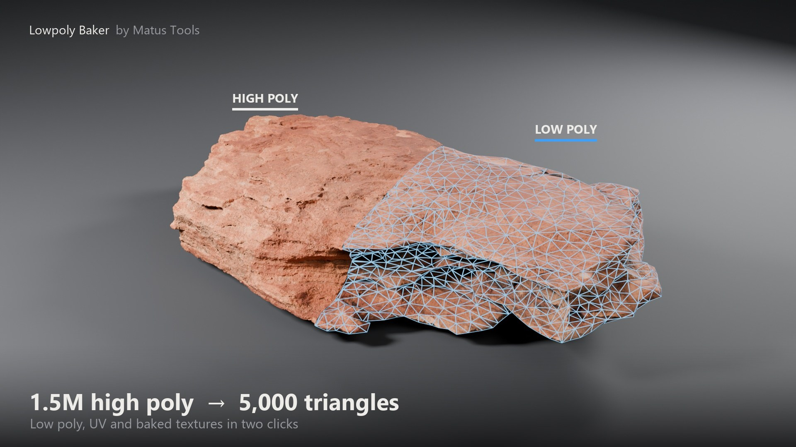

# Matus Tools

Blender add-ons for making realistic, game-ready assets faster.
Documentation, release notes and bug reports. The add-ons themselves are sold on [Patreon](https://www.patreon.com/MatusTools).

| Add-on | What it does | Docs |
|---|---|---|
| **Lowpoly Baker** | High-poly model or scan → game-ready low poly with baked textures, in two clicks | [Lowpoly Baker](lowpoly-baker/README.md) |

## Links

- Shop: [Patreon](https://www.patreon.com/MatusTools)
- Videos: [YouTube](https://www.youtube.com/@Matus_Tools)
- News: [X](https://x.com/MatusTools)

## Found a bug?

Open an issue with the **Bug report** template: [New issue](../../issues/new/choose).
Please include the add-on version, the Blender version and your operating system.
