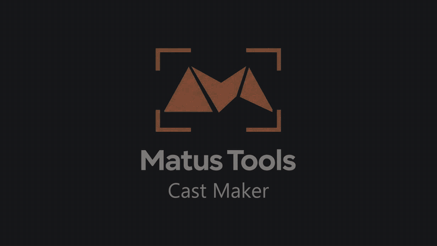
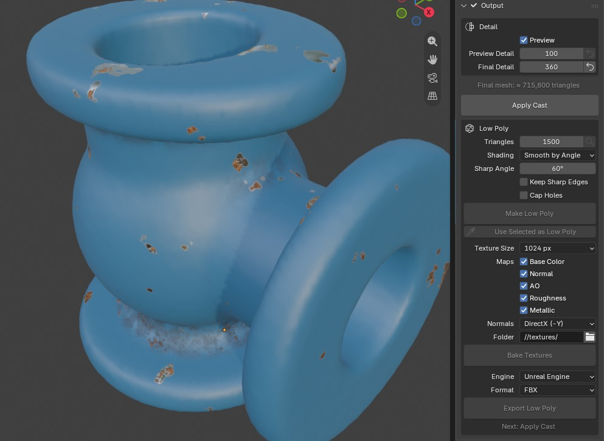

# Cast Maker

Cast parts from simple primitives: the parts melt together with fillets, the edges get rounded, the
surface gets a casting grain, paint and wear. Then a game-ready low poly with baked textures,
exported for Unreal Engine, Unity or Godot, without leaving the add-on.
Blender 5.0 and newer.

**Get it:** [Patreon](https://www.patreon.com/MatusTools/posts/cast-maker-add-175587248) · [BlendSwap](https://blendswap.com/blend/35353) · [BlenderKit](https://www.blendkit.com/asset-gallery-detail/47008cfb-c1b0-45cc-a4dd-a5f131b9d0c0/) · **Watch:** [YouTube video](https://www.youtube.com/watch?v=Wc8dl5I74pE)

## Install

1. Download `cast_maker-<version>.zip`. Do not unzip it.
2. Drag the zip into the Blender window and confirm.
   Or: Edit > Preferences > Get Extensions > the arrow menu at the top right > Install from Disk… > choose the zip.
3. In the 3D View press **N** and open the **Cast Maker** tab.

To update, install the new zip the same way and restart Blender. Your Prototype Library and surface presets are kept.
To remove: Edit > Preferences > Add-ons > Cast Maker > the arrow menu > Uninstall.

## Quick start

1. Press **Cylinder**, **Box**, **Pipe**… under **Add Primitive** (the first one starts a cast), or select your own
   closed meshes and press **New Cast**. Let the parts overlap where they should join.
2. The **−** next to a primitive adds it as a cut. Or select objects and press **Cut Shape** (a pocket or window,
   painted) or **Cut Metal** (a bore or drilled hole, bare metal inside).
3. Set **Fillet** and **Rounding** under **Shape (mm)**. Switch **Show** to **Cast Only** or **Both** to see the cast.
4. Pick a **Preset** under **Surface** and tune the wear: edge wear, chips, rust, streaks, dirt.
5. **Apply Cast** → **Make Low Poly** → save the .blend → **Bake Textures** → **Export Low Poly**.

Each button waits for the one before it; a greyed-out button tells the missing step in its tooltip,
and the line under Export names the next step. **Esc** cancels Make Low Poly and Bake Textures at any time.

Or start from a ready prototype: choose **Angle Valve**, **Flange Pipe** or **Handwheel** in the
**Prototype Library** and press **Add to Scene**.

## Cast

| Setting | |
|---|---|
| New Cast | A new cast from the selected meshes. With nothing selected, the next primitive starts it. |
| Editing | The cast the panel works on. Click a cast, one of its parts or its low poly to switch. The bin deletes the cast with its parts, cuts, low poly and collections (Ctrl+Z brings it back). |
| Prototype Library | Your casts kept for every project. **+** saves the active cast, **−** deletes, then duplicate and rename. **Add to Scene** puts the chosen one at the 3D cursor. The three samples cannot be deleted; duplicate them to make your own. |
| Parts / Cut Shape / Cut Metal | Put the selected objects into the cast as parts, painted cuts or bare-metal cuts. |
| Bare Ends / Bare Inside | For a selected Pipe: its end rims / its inner wall as bare metal, or painted. |
| Check Parts | Selects parts with holes in their surface (they cast wrong) and parts far from the rest (they can empty the cast). |
| Add Primitive | Cylinder, Box, Sphere, Torus, Cone, Pipe (straight or bent) at the 3D cursor. Sizes in millimetres in the redo panel (F9); the cast is rebuilt when you go on. |
| Shape (mm) | **Fillet**: radius of the fills where parts meet. **Rounding**: radius of the outer edges. Both are limited by the part size; the panel shows the limit. |
| Show | **Parts Only** (fast editing, the cast is not calculated), **Cast Only**, **Both**. |

## Surface

| Setting | |
|---|---|
| Preset | Built-in looks (Blue Paint, Old Rusty, Raw Cast Iron, Cast Iron, Green Machinery, Red Valve, Black Paint, Orange Paint) and your own: **+** saves the whole surface, **−** deletes your preset. |
| Casting (mm) | **Roughness**: height of the casting grain. **Grain Size**: its size. |
| Wear | Edge Wear, Chips, Rust, Streaks and Dirt, each on or off with an amount. |
| Paint / Metal / Rust / Dirt | Colour and roughness of each surface. Metal also has Age (dull, darker, pitted), Scratches and their length. |
| Pattern | Unevenness, spot size and seed of the wear. |

Bores, pipe insides and every surface left by a Cut Metal stay clean bare metal. Where the paint ends at a
bore or a pipe end, the border gets chipped, rusty and dirty as much as the wear is set.

## Output

| Setting | |
|---|---|
| Preview / Preview Detail / Final Detail | Coarse and fast while you edit; voxels across the part for the preview and for the final cast. Preview switches itself off while Make Low Poly, Suggest and Bake read the cast and comes back afterwards. |
| Apply Cast | A plain mesh of the cast at full detail, `<cast>_High`. Pressed again it replaces the earlier one. |
| Triangles | Budget of the low poly. The magnifier (**Suggest**) sets the smallest budget that keeps the shape within one texel at the chosen Texture Size. |
| Shading / Sharp Angle | Smooth by Angle (default), Smooth or Flat. |
| Keep Sharp Edges | Holds machined rims and sharp edges at any budget. Only when a rim loses its shape. |
| Cap Holes | The low poly closes pipes and holes wider than **Min Hole** with a dark disc **Cap Depth** radii in: no triangles or texture spent on inner walls. |
| Make Low Poly | `<cast>_LOW`, built from the cast without the grain, unwrapped. Again = replaced. |
| Use Selected as Low Poly | Your own low poly instead (a UV is made if it has none). |
| Texture Size / Maps / Normals / Folder | 256 to 4096 px; Base Color, Normal, AO, Roughness, Metallic; OpenGL or DirectX (follows the Engine); `//` = next to the saved .blend. |
| Bake Textures | Bakes grain, paint, wear and bare metal onto the low poly and gives it a material. Each bake replaces the previous one of that low poly. |
| Engine / Format / Export Low Poly | Unreal Engine, Unity, Godot or Other; FBX, glTF or OBJ. Units, axes and texture names follow the Engine; a preview image is written next to the model. |

## Tips

- Sizes in Cast Maker are in millimetres, whatever units the scene uses.
- Parts must be closed meshes. **Check Parts** finds the ones that are not.
- Final Detail 220 takes a few seconds for a 15 cm part; 400 and more can take much longer.
- Machined edges follow the voxels: raise Final Detail if a rim looks stepped.
- Lowpoly Baker is not needed: the low poly and the bake are built in (both add-ons can be on together).

[Release notes](CHANGELOG.md) · [Report a bug](https://github.com/Roman-Matus/matus-tools/issues/new/choose)
