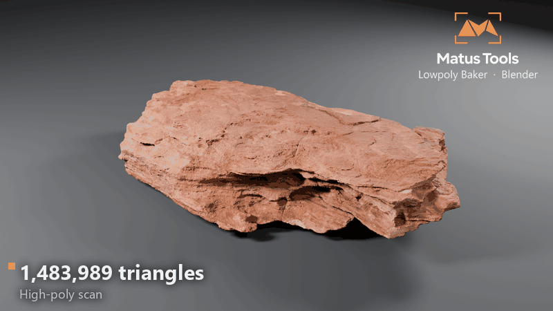
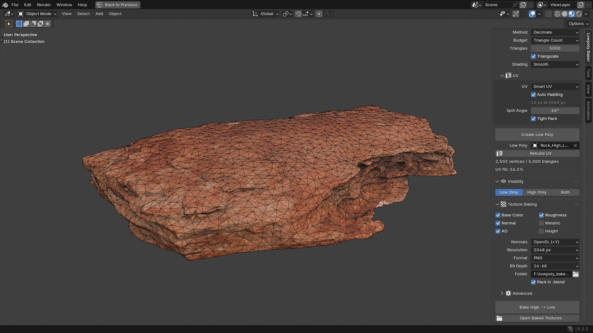
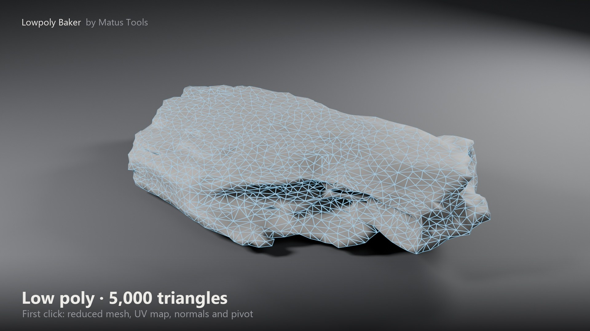
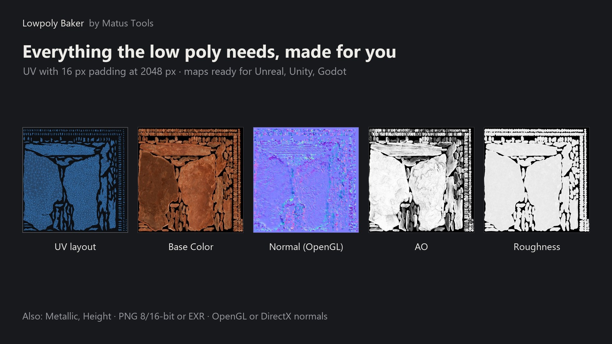

# Lowpoly Baker

From a high-poly model or scan to a game-ready low poly with baked textures, in two clicks,
exported for Unreal Engine, Unity or Godot.
Blender 4.2 and newer.

## Install

1. Download `lowpoly_baker-<version>.zip`. Do not unzip it.
2. Drag the zip into the Blender window and confirm.
   Or: Edit > Preferences > Get Extensions > the arrow menu at the top right > Install from Disk… > choose the zip.
3. In the 3D View press **N** and open the **Lowpoly Baker** tab.

To update, install the new zip the same way and restart Blender.
To remove: Edit > Preferences > Add-ons > Lowpoly Baker > the arrow menu > Uninstall.

## Quick start

1. Select your detailed model and press **Use Selected as High Poly**.
2. Set **Triangles** to the triangle budget you want.
3. Press **Create Low Poly**. A copy named `<model>_LOW` appears.
4. Save the .blend file (textures are saved next to it, in `textures`).
5. Tick the maps you need and choose the **Resolution**.
6. Press **Bake High -> Low**.
7. Done: the low poly now has a material with the baked textures. **Open Baked Textures** opens the folder.
8. Choose the **Engine** and **Format** and press **Export Low Poly**: the model file and its preview image are written next to the textures.

Press **Esc** at any time to cancel; nothing half-made is left behind.
A greyed-out button shows the missing step in its tooltip.

## Models

| Setting | |
|---|---|
| High Poly | The detailed source. Read with its modifiers, never edited. |
| Method | **Decimate** keeps the original shape and open edges. **Voxel + Decimate** first rebuilds a closed, even mesh: fills holes, loses parts thinner than a voxel. |
| Budget | **Triangle Count** (aim for a number) or **Ratio** (keep a share). |
| Triangulate | Triangles only. Keep it on: the normal map then looks the same in every engine. |
| Shading | **Smooth** (best for organic shapes and normal maps), **Smooth by Angle** (hard edges above Sharp Angle) or **Flat**. |

### UV

| Setting | |
|---|---|
| Smart UV | Unwraps the copy automatically (recommended). |
| Keep UV | Keeps the source UV. It must not overlap. |
| Auto Padding | Space between islands and to the texture border, set from the Resolution (8 px at 1024). Untick to set it by hand. |
| Split Angle | Lower = more, flatter islands; higher = fewer seams. |
| Tight Pack | Packs islands by their real outlines to use more texture. |
| Rebuild UV | Unwraps the Low Poly again. Bake again afterwards. |

## Texture Baking

| Setting | |
|---|---|
| Maps | Base Color, Normal, AO, Roughness, Metallic, Height. Base Color, Roughness and Metallic are read from the Principled BSDF of the source material. |
| Engine | Names the textures in the engine's convention, with the resolution (1K, 2K, 4K): see the table below. The same setting as Engine in Export. |
| Normals | OpenGL (Blender, Unity, Godot) or DirectX (Unreal Engine). |
| Resolution | Size of every texture, 256 to 4096 px. |
| Format | PNG (8 or 16 bit) for engines, EXR 32-bit for further work. |
| Folder | Where textures go. Every bake makes a new dated subfolder. |
| Pack in .blend | Also stores the textures inside the .blend file. |

**Texture names.** The resolution comes before the map token, and the map token is last:

| Engine | Textures | Model |
|---|---|---|
| Unreal Engine | `T_Rock_2K_BC`, `_N`, `_AO`, `_R`, `_M`, `_H` | `SM_Rock.fbx` |
| Unity | `Rock_2K_Albedo`, `_Normal`, `_Occlusion`, `_Roughness`, `_Metallic`, `_Height` | `Rock.fbx` |
| Godot | `Rock_2K_albedo`, `_normal`, `_ao`, `_roughness`, `_metallic`, `_height` | `Rock.glb` |
| Other | `Rock_2K_base_color`, `_normal_dx` / `_normal_gl`, `_ao`, `_roughness`, `_metallic`, `_height` | `Rock.fbx` |

Unreal Engine sets normal map compression by itself from the `_N` suffix. Names are set when you bake; if you then export for another Engine, the add-on warns that the textures are named for the previous one.

**Advanced:** Device (Auto uses the GPU if one is enabled in Preferences), Bake Samples, Bake Margin, and **Auto Ray Distances**: the add-on measures how far the two models are apart and sets the ray distances itself. Untick to set Ray Start Offset and Projection Distance by hand.

## Export

| Setting | |
|---|---|
| Engine | Sets units and axes, and the default Format. **Unreal Engine**: metres become centimetres (FBX). **Unity**: scale 1, Y up with the rotation applied (FBX). **Godot**: scale 1, Y up (GLB). **Other**: Blender units and axes as they are. |
| Format | **FBX**: smoothing groups and tangents, textures as files. **glTF Binary (.glb)**: one file with the textures inside, AO as occlusion. **glTF Separate (.gltf)**: .gltf + .bin, textures in a `<model>_gltf` folder. **OBJ**: the simplest, no tangents and no AO; the .mtl links the textures. |
| Next to Textures | Writes the model into the folder of the last bake. Untick to choose a Folder: all maps are copied with the model. |
| At World Origin | Exports the model as if it stood at the world origin, so its pivot is the asset origin in the engine. |

Every export also renders the asset preview `<model>_preview.png` into the same folder: 1024 × 1024, transparent background, three-quarter view, the model with its baked material under studio light. It is rendered in a temporary scene, so your camera, lights and render settings stay as they are.

Bake Normals as DirectX for Unreal and OpenGL for Unity and Godot (glTF always uses OpenGL); the add-on warns if they do not match. The scene is not changed by an export. In FBX, AO is not on the material (FBX has no input for it): connect it in the engine.

## What you get

A folder `<model>_LOW_<date>_<time>` with one file per map, named for the Engine (for Unreal Engine at 2K: `T_<model>_LOW_2K_BC.png`, `T_<model>_LOW_2K_N.png`, ...) and `bake_report.json` with the settings used. The low poly gets a new material `<model>_LOW_Baked` with these textures. **Export Low Poly** adds the model (`.fbx`, `.glb`, `.gltf` or `.obj`; `SM_<model>_LOW.fbx` for Unreal Engine) and its preview `<file>_preview.png`.

## If something looks wrong

| Problem | Fix |
|---|---|
| Holes or black spots | Keep Auto Ray Distances on. If they stay, untick it and raise Projection Distance. |
| Details from the wrong side show through | Untick Auto Ray Distances and lower Projection Distance. |
| Seams in the normal map | Use Shading: Smooth, or keep Triangulate on. |
| "Save the .blend first" | The texture folder is next to the .blend file. |
| Colour maps refused | Each source material needs one Principled BSDF connected to the Material Output. |

## Limits

- One High Poly and one Low Poly at a time.
- AO, Roughness and Metallic are saved as separate textures (no packed ORM texture yet).
- No custom cage mesh and no LOD generation yet.
- Smart UV usually fills about half of the texture on irregular shapes such as rocks. For a tighter layout make your own UV and use Keep UV.
- Geometry Nodes instances must be realized in the source to be baked.

## Release notes

See [CHANGELOG](CHANGELOG.md).

---
Rock scan in the images: Megascans "Rock Sandstone" (Fab).
© Matus Tools. The add-on code is GPL-3.0-or-later; images, help text, names and logo are © Matus Tools.
